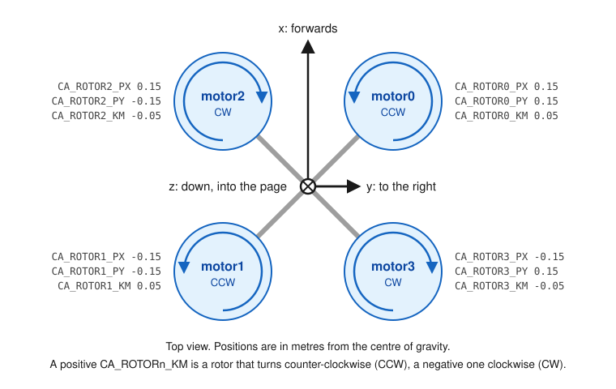

# Reading a report

This page goes through the parts of a report, using
[`examples/standard_vtol_pusher_offset.params`](../examples/standard_vtol_pusher_offset.params):
PX4's SIH standard VTOL with the pusher motor moved 5 cm above the centre of
gravity. The whole report is in
[example-reports/standard_vtol_pusher_offset.md](example-reports/standard_vtol_pusher_offset.md).

## Axes and signs

PX4 describes forces and torques in the body frame of the vehicle: x points
forwards, y to the right and z down.



The figure shows the quadrotor of
[`examples/quad_qgc_export.params`](../examples/quad_qgc_export.params). The
six axes of a report are three torques and three forces in that frame:

| Axis | Positive means |
|---|---|
| roll | torque that lowers the right side |
| pitch | torque that raises the nose |
| yaw | torque that turns the nose to the right |
| thrust_x | force forwards |
| thrust_y | force to the right |
| thrust_z | force down; the thrust that lifts a vehicle is negative |

`motorN` in a report is the rotor configured by `CA_ROTORN_*`. Servos are
numbered as in PX4, starting at 0: control surfaces (`CA_SV_CSn_*`) first,
then tilt servos (`CA_SV_TLn_*`).

## The header

```
Input:     examples/standard_vtol_pusher_offset.params (plain format, 26 parameters)
PX4:       v1.17.0 (d6f12ad1c4)
Airframe:  CA_AIRFRAME 2 (Standard VTOL)
Actuators: 5 motors, 3 servos
```

- **Input**: the file, the format it was read as and the number of parameters
  that were read from it.
- **PX4**: the version and commit the engine was built against. The matrices
  are the ones this PX4 version computes; another version can compute others.
- **Airframe** and **Actuators**: what PX4 made of the parameters. Compare
  them with the vehicle before reading on.

A **Notes** section follows when something about the input needs saying, for
example that the file has parameters this PX4 version does not know.

## Matrices

PX4 can use more than one matrix. For a standard VTOL, matrix 0 holds the
motors and matrix 1 the control surfaces. The heading names the allocation
method PX4 uses for the matrix.

### Effectiveness

```
  Effectiveness: what each actuator produces on each axis
  axis        motor0    motor1    motor2    motor3    motor4
  roll        -1.300     1.300     1.300    -1.300     0.000
  pitch        1.300    -1.300     1.300    -1.300    -0.325
  yaw          0.325     0.325    -0.325    -0.325     0.000
  thrust_x     0.000     0.000     0.000     0.000     6.500
  thrust_y     0.000     0.000     0.000     0.000     0.000
  thrust_z    -6.500    -6.500    -6.500    -6.500     0.000
```

One column per actuator: what it produces on each axis at full command. This
is PX4's picture of the vehicle, computed from positions, axes and
coefficients.

Read it column by column and compare with the vehicle:

- motor0 to motor3 have a thrust_z of -6.5: they lift. Their roll and pitch
  values have the signs of their positions; motor0, front right, lowers the
  left side (negative roll) and raises the nose (positive pitch).
- motor4, the pusher, has a thrust_x of 6.5: it pushes forwards. Its pitch
  value of -0.325 is the 5 cm offset of this example: thrust above the centre
  of gravity pushes the nose down.

A sign that does not match the vehicle is a wrong parameter, whether or not a
rule reports it.

### Mix

```
  Mix: actuator command per unit of setpoint on each axis
  actuator      roll     pitch       yaw  thrust_x  thrust_y  thrust_z
  motor0      -0.707     0.707     1.000     0.250     0.000    -1.000
  ...
  motor4       0.000     0.000     0.000     4.000     0.000     0.000
```

One row per actuator: how its command changes when the controller asks for
one unit on an axis. PX4 computes the mix from the effectiveness matrix, and it
is what the vehicle flies with.

In this example the thrust_x column shows the effect of the offset: the lift
motors get 0.25 and -0.25 to cancel the pitch torque of the pusher, and the
pusher gets 4.0, so its output is at its limit at a thrust_x setpoint of 0.25.
Both are findings below.

### Axes

```
  Axes
  roll      controlled (authority 5.200)
  pitch     controlled (authority 5.525)
  yaw       controlled (authority 1.300)
  thrust_x  controlled (authority 6.500)
  thrust_y  not controlled
  thrust_z  controlled (authority 26.000)
```

What PX4 does with each axis of this matrix. "not controlled" means no
actuator of the matrix has an effect on the axis, which is normal for thrust_y
of most vehicles and for the thrust axes of a matrix of control surfaces.
Other states are "weak, zeroed by PX4" ([CA004](../rules/CA004.md)) and
"dropped by PX4" ([CA002](../rules/CA002.md)).

Authority is the sum of the absolute effectiveness values on the axis. It is a
number for comparing two configurations of one vehicle, not a physical unit.

## Flight phases

```
Flight phases: motors PX4 stops in a flight phase, whatever the setpoint
  hover                         none
  transition to forward flight  none
  forward flight                motor0, motor1, motor2, motor3
  transition to hover           none
```

Only for VTOLs. PX4 stops some motors in a flight phase whatever the
controllers ask for: here the four lift motors in forward flight. The section
also prints the mix of the motors that are left in such a phase.

## Findings

```
Findings
  warning CA010 matrix 0: motor4: thrust_x gain up to 4.00 (limit 2); the output saturates at a thrust_x setpoint of 0.25
      thrust gain above the limit: https://github.com/Abtektas/px4-ca-lint/blob/v0.4.0/rules/CA010.md
  warning CA011 matrix 0: motor0, motor1, motor2, motor3: commanded by the thrust_x setpoint without producing thrust_x thrust; a thrust_x setpoint changes their output
      thrust command to an actuator that produces no thrust on that axis: https://github.com/Abtektas/px4-ca-lint/blob/v0.4.0/rules/CA011.md
  CA002 was not checked: this PX4 version does not report dropped axes
  0 error(s), 2 warning(s)
```

Each finding has a level, a rule, where it was found and what was found. The
indented line is the title of the rule and the link to its page.

A line such as "CA002 was not checked" names a rule that could not run with
this engine, and why. The [table of rules](../README.md#findings) lists all of
them.

The last line of every report is the disclaimer. It is part of the report on
purpose: a report without findings is not a statement that a configuration is
safe.

## The same report in other formats

`--format markdown` prints the report for pasting into an issue, with the
matrices folded away. `--format json` prints everything for other programs,
including the parameters that were read.
